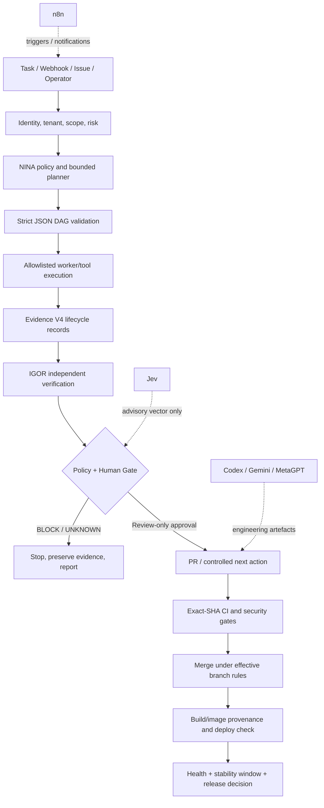

# OLA di-OS — agent and tool profile catalogue

**Audit date:** 2026-11-17  
**Canonical repository:** `krzysztofcieciwa07-ship-it/OLA`  
**Audited source:** `8adf30cd5e41a18a5345f66e67f5ddcdbc164862`  
**Rule:** distinguish implemented runtime behaviour from external tooling, references, and planned adapters.

## 1. How to read this catalogue

- **IMPLEMENTED** means source code exists in the audited OLA commit. It does not automatically mean the feature is enabled in a deployed environment.
- **FEATURE-GATED** means code exists but requires an explicit configuration flag.
- **ADVISORY** means the component may provide a recommendation but cannot authorize an action or set `VERIFIED`.
- **REFERENCE ONLY** means a repository or framework is available for study but is not connected to the OLA runtime.
- **NOT INTEGRATED** means no OLA runtime adapter or proven execution path was found in the audited source.
- **VERIFIED RUN** applies only to the named run, commit, and evidence scope. It is not a blanket claim about production readiness.

## 2. Core OLA runtime profiles

### 2.1 NINA — orchestration and policy-facing planner

**Status:** IMPLEMENTED; bounded DAG endpoint FEATURE-GATED.

**Purpose:** receive a tenant-scoped task, validate requested capabilities against the registered tool set, and route work through the existing OLA execution runtime.

**Current implementation:**
- `app/nina.py` defines `NinaTask`, `NinaDecision`, `NinaOrchestrator` and the registered capability names.
- `app/nina_execution.py` runs the existing sequential role runtime, constructs provenance and decision reports, and invokes IGOR/replay checks.
- `app/nina_workflow.py` obtains a real LLM-produced JSON DAG, validates exact fields, IDs, dependencies, cycle constraints and allowlisted tools, then submits it to `WorkflowEngine`.
- `app/main.py` exposes `POST /nina-run` and `POST /nina-workflow`. Parallel workflows are disabled unless `OLA_PARALLEL_WORKFLOWS_ENABLED=1`.

**Boundaries:**
- NINA does not create proof of correctness by deciding that a task is allowed.
- The DAG accepts 1–16 nodes; the current workflow engine is bounded to 1–8 workers (NINA configures 4) and a deadline of up to one hour (default 300 seconds).
- The DAG tool boundary is limited to `safe_expression`, `local_mcp_tool_registry.sha256`, and `llm_agent`.
- The planner requires a real model invocation and response provenance; malformed or unallowlisted JSON is rejected.
- Workflow completion is `COMPLETED_UNVERIFIED`, not `VERIFIED`.

**Evidence required:** exact source SHA, plan digest, task start/completion/failure events, persisted Evidence V4 records, independent IGOR report, replay/tamper result, then separate Human Gate where required.

### 2.2 Six registered execution roles — not six independent agents

**Status:** IMPLEMENTED as six sequential in-process role paths.  
**Source:** `app/agent_runtime.py`; registry in `app/agent_registry.py`.

Each role receives the task and previous output, may invoke the configured model adapter, then executes its registered capability. Model output is explicitly recorded as advisory; the result comes from the registered capability.

| Role ID | Implemented behaviour | What it is not |
|---|---|---|
| `codeact` | Uses a restricted AST arithmetic evaluator. Allows a small set of arithmetic operators, with task-size, AST-node, nesting-depth, and numeric bounds. | Not a shell, Python, or general code execution sandbox. |
| `react` | Emits a fixed reason/act/observe structure based on the previous role output. | Not an autonomous tool loop with dynamic tool selection. |
| `agentic_rag` | Looks at at most the ten most recent records for the same tenant and performs simple token/substring matching. | Not embedding-based RAG, not a vector index, and not cross-tenant retrieval. |
| `mcp_tool_use` | Calls the internal allowlisted SHA-256 function. The local helper registry also contains a length function. | Not an unrestricted MCP client or arbitrary remote tool runner. |
| `self_reflection` | Checks that the previous output is nonempty and does not contain a basic error marker. | Not proof of semantic correctness or independent model review. |
| `multi_agent` | Aggregates the role outputs already collected in the same run. | Not distributed or parallel agent cooperation. |

**Identity and isolation facts:**
- Each role evidence event carries an `agent_instance_id`, context and input digests, source commit, provider/model metadata and a status.
- The implementation explicitly records `execution_boundary: in_process`.
- The loop executes the six roles sequentially in the same Python runtime.
- A unique UUID per role execution is not proof of a separate process, container, machine, or autonomous agent.
- The registry's `agent-001` style identifiers are simple registry IDs; they do not create worker isolation.

**Acceptance rule:** never describe these six paths as “six independent autonomous agents” until each has a distinct process/instance identity, isolated context, explicit provider invocation, tool boundary, communication evidence, lifecycle evidence, and independent verification.

### 2.3 OpenAI provider profile

**Status:** IMPLEMENTED in `app/agent_runtime.py`; actual invocation depends on runtime configuration.

**Purpose:** provide model output to an OLA role or NINA planner through the existing provider boundary.

**Configuration:** `OLA_LLM_PROVIDER=openai`, `OLA_LLM_MODE=required`, explicit `OLA_LLM_MODEL`, `OPENAI_API_KEY`; optional `OPENAI_BASE_URL` must use HTTPS and an approved host.

**Controls:** missing key/model or an unapproved host blocks required-mode execution; bounded timeout; response ID and prompt digest recorded. Model output is advisory and cannot prove a tool action or authorize a human decision.

### 2.4 Ollama provider profile

**Status:** IMPLEMENTED in `app/agent_runtime.py`; live use requires an available Ollama endpoint and required-mode configuration.

**Purpose:** local or approved-host model inference through the same provider boundary.

**Configuration:** `OLA_LLM_PROVIDER=ollama`, `OLA_LLM_MODE=required`, `OLA_LLM_MODEL` or `OLLAMA_MODEL`, and `OLLAMA_BASE_URL`. Plain HTTP is restricted to loopback; remote endpoints require HTTPS and an explicit host allowlist.

**Controls:** real invocation metadata and response ID are required where real model execution is claimed. The bounded NINA planner uses a strict JSON plan contract. Deterministic fallback must not be presented as a live Ollama call.

### 2.5 IGOR — independent evidence verifier

**Status:** IMPLEMENTED as a separate verification component; CI has a successful independent evidence run on the audited main SHA.

**Purpose:** recompute evidence integrity and validate the captured task/workflow lifecycle instead of trusting NINA's success field.

**Current checks include:** tenant consistency, record-chain integrity, trusted producer/event binding, plan digest, dependency order, unique task start/completion, input/output digests, measured worker interval, model provider/response metadata for LLM nodes, and terminal event completeness. The standalone evidence workflow additionally tests tamper rejection and captures an evidence bundle.

**Limitations:**
- IGOR verifies the captured record and its declared trust scope; it cannot prove that arbitrary external observations are true merely because they have hashes.
- The in-application DAG verifier reports trust scope as `LOCAL_HASH_CHAIN_AND_CAPTURED_RUNTIME_EVENTS`.
- An IGOR `VERIFIED` result is not a Human Gate approval, GitHub review, merge permission, deployment authorization, or production certification.

### 2.6 Human Gate

**Status:** IMPLEMENTED as identity-separated, tip/report-bound review paths; deployment authorization remains separate.

**Current behaviour:** requester and approver identities must differ; the approval is bound to the exact evidence-chain tip and report digest; the chain tip is rechecked before append. The workflow approval endpoint explicitly returns review-only approval and `production_authorized: false`.

**Boundary:** a caller-supplied boolean, model recommendation, Jev response, worker token, or successful CI run is not a human approval.

## 3. External engineering and agent profiles

### 3.1 Codex — coding and repository-work profile

**Status:** EXTERNAL ENGINEERING TOOL; NOT AN OLA RUNTIME PROVIDER.

**Purpose:** inspect repositories, plan focused code changes, edit files, add tests, run checks, and produce commits/PRs.

**Allowed workflow:**
1. Read canonical `main`, open PRs, source SHA and repository rules before editing.
2. Work only in a focused topic branch/worktree.
3. Preserve existing API and evidence contracts; do not create a parallel executor or verifier.
4. Run targeted tests, full relevant checks, security scans and exact-SHA CI.
5. Push a normal fast-forward branch update and open/update a PR.
6. Do not approve or merge its own work, change repository security settings, rotate secrets, or deploy.

**Integration status:** no direct Codex adapter/provider was found in the OLA application source. Codex is a development lane, not a production runtime agent.

### 3.2 Gemini Agent / Agent OS — research and review profile

**Status:** NOT INTEGRATED INTO OLA CORE.

**Potential role:** independent research, second-pass review, design critique, test suggestions, and controlled engineering contributions through topic branches.

**Required before integration:** a named provider adapter, stable agent/service identity, structured JSON input/output schemas, provider/model/request IDs, outbound network allowlist, scoped capability permissions, budget/timeout/retry limits, Evidence V4 writer, IGOR checks and a separate human approval boundary.

**Current limitation:** the audited OLA runtime provider selector supports OpenAI and Ollama. No Gemini runtime invocation or Gemini Agent OS execution adapter was confirmed. Do not label Gemini as an active OLA agent until a real run is captured and independently verified.

### 3.3 Jev / TypeSafe System One — advisory evaluation profile

**Status:** ADVISORY; manual GitHub Actions workflow exists.

**Source:** `.github/workflows/jev-evaluation.yml`.

**Function:** request a typed decision vector containing review-needed, route (`allow_candidate`, `review`, or `block`), confidence/probability fields, and evidence-quality score.

**Authority:** advisory only. The workflow explicitly states that Jev is not verification, cannot promote to `VERIFIED`, and leaves the final decision to the OLA verification chain.

**Operational status:** the inspected Actions run set contained no execution of this Jev workflow. The existence of `TYPESAFE_API_KEY` in the workflow declaration does not prove that the secret is configured or that Jev has been called. No secret value is inspected or disclosed.

### 3.4 MetaGPT — multi-agent software-team framework reference

**Status:** REFERENCE ONLY; NOT AN OLA RUNTIME INTEGRATION.  
**Repositories:** [owner fork](https://github.com/krzysztofcieciwa07-ship-it/MetaGPT), [upstream project](https://github.com/FoundationAgents/MetaGPT).

**What MetaGPT provides:** an external framework that models software-production work as a collaboration of role-based LLM agents (for example product management, architecture, project management, and engineering) coordinated by standard operating procedures. Its upstream documentation describes transformation of a natural-language requirement into artefacts such as user stories, analysis, requirements, data structures, APIs, and code.

**Correct use in the OLA ecosystem:**
- reference architecture for decomposing a software task into specialist roles and ordered handoffs;
- research source for team/SOP design and agent collaboration patterns;
- optional candidate adapter behind NINA only after a dedicated security and runtime review.

**Not true today:**
- MetaGPT is not imported by `app/`, not listed as a direct OLA runtime dependency in `requirements.txt`, and not invoked by NINA;
- its roles are not the same as OLA's six registered role IDs;
- its output is not OLA Evidence, IGOR verification, or Human Gate approval;
- the existence of the fork does not establish that its agents are running in OLA.

**License:** the fork is identified as MIT-licensed. If code is copied or vendored, retain the MIT copyright and license notice and preserve notices for its dependencies. OLA's root Unlicense does not relicense MetaGPT or its third-party dependencies.

**Potential integration contract:** NINA submits a bounded task and strict schema; MetaGPT runs in an isolated worker with a dedicated provider identity and explicit tool/network allowlist; the adapter returns typed artefact references and digests; OLA writes lifecycle evidence; IGOR verifies provenance and integrity; Human Gate decides any privileged or externally visible action. Until that contract is implemented and tested, MetaGPT remains a reference, not an executor.

### 3.5 n8n — external automation and connector profile

**Status:** SERVICE ONLINE; FULL WORKFLOW NOT CONFIGURED.

**Intended function:** webhooks, scheduled triggers, connector orchestration, notifications, and controlled API calls into OLA.

**Observed service state:** Railway production reports the n8n service online with one running replica and a successful deployment. The inspected startup logs reported zero draft and zero published workflows, sandbox disabled, and a Python task-runner startup failure because Python 3 was absent from the container.

**Required architecture:** n8n triggers OLA APIs; it does not replace NINA, the Evidence writer, IGOR, or the Human Gate. No credentials should be exposed to client-side workflows. The current production service status is not proof of a working OLA end-to-end workflow.

### 3.6 Local Agent and Cockpit Preview

**Status:** local helper contract exists; live device enrollment/owner authorization is NOT VERIFIED. Cockpit stays PREVIEW-ONLY.

The Windows helper is intended to bind to loopback, hold an ephemeral runtime token in memory, validate origin/host, and expose restricted local health/telemetry/model operations. It is not a persistent device identity or remote enrollment mechanism.

Cockpit preview controls must be demonstrative and read-only. No preview action may perform real write, shell execution, approval, retry, deployment, or device revocation. Real operation requires owner authentication, device enrollment, session revocation, exact API scope, source binding and audited approvals.

## 4. Evidence Gateway — repository and service distinction

The related `ola-evidence-gateway` repository is currently catalogued as a specification/reference, not a deployed API service. The catalogue records that it has documentation paths but no verified server, API, tests or container deployment.

**Decision:** keep Evidence V4 writer, append-only persistence, IGOR and existing API as the current evidence path. Do not introduce a second gateway service just to duplicate these boundaries. A future gateway requires a precise API contract, threat model, tests, deployed endpoint, ownership, Evidence records and independent IGOR verification.

## 5. End-to-end work pipeline

### Status of each pipeline boundary

| Boundary | Current source of truth | Acceptance condition |
|---|---|---|
| Task intake and tenant identity | FastAPI auth and tenant-scoped API routes | Valid tenant identity; request limits and policy check pass |
| Planning | NINA / strict JSON DAG planner | Real model provenance, strict schema, allowlisted tools |
| Execution | Registered capabilities and bounded WorkflowEngine | Time/output/concurrency bounds; no unapproved external side effects |
| Evidence | Evidence V4 and append-only tenant chain | Durable start/step/end events, correct chain and source binding |
| Verification | IGOR and replay verifier | Recomputed chain and semantics; tamper must BLOCK |
| Human review | Human Gate | Distinct authenticated reviewer bound to exact digest/tip |
| Coding changes | Codex/Gemini topic branch and PR | Exact-SHA CI plus independent review; never self-merge |
| Advisory evaluation | Jev/TypeSafe | Typed response recorded as advisory, never authority |
| External triggers | n8n | Workflows imported, credentials scoped, end-to-end test evidence |
| Release | GitHub + deployment platform | Protected main, exact source/image provenance, runtime health and stability |

## 6. Conditions for a new profile to be called integrated

A new framework, provider, coding agent, or external service is not “integrated” until all of the following exist:

1. named owner and security classification;
2. stable execution identity and tenant scope;
3. strict request/response JSON schema with versioning;
4. explicit capability registry and least-privilege permission set;
5. execution isolation, resource limits and network allowlist;
6. secret custody and rotation procedure;
7. bounded retries/timeouts and cancellation semantics;
8. start/end/failure evidence and immutable artifact references;
9. exact source/build/model/provider provenance;
10. independent IGOR verification including tamper and replay tests;
11. separate Human Gate for privileged actions;
12. CI and runtime proof on the exact candidate SHA;
13. documented rollback and operator runbook.

Until then, classify it as `REFERENCE_ONLY`, `PROPOSED`, or `NOT_INTEGRATED`.
